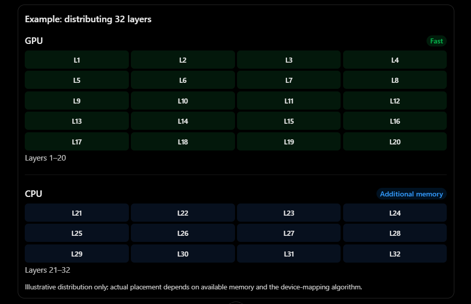

```
device_map="auto"
```

### **What does **`device_map="auto"`** mean?**

It tells Hugging Face to automatically decide where to place the model's layers based on the available hardware and memory.

For example:

* If sufficient GPU memory is available, it can place the model on the GPU.
* If GPU memory is insufficient, it may distribute parts across GPU and CPU, depending on the loading configuration.
* If multiple GPUs are available, it can distribute model layers across them.

**Why do we use it?**

A large model such as Llama 2 7B requires substantial memory. Automatically assigning model layers helps manage available hardware without manually specifying the device for every layer.

### **Interview-ready answer**

`device_map="auto"` uses Hugging Face Accelerate's automatic device mapping to place model layers across available hardware, helping load large models efficiently according to available memory.

### **Important distinction**

* `torch_dtype=torch.float16` → controls the numerical precision used for model weights.
* `device_map="auto"` → controls where model layers are placed.

**Quick question:** Suppose your system has a GPU with insufficient memory to hold the entire model. What is the primary purpose of `device_map="auto"`?

A. Convert the model into 4-bit quantization.

B. Automatically determine device placement for model layers.

C. Fine-tune the model using multiple GPUs.

D. Reduce the number of model parameters.

### **1. First, what are layers in an LLM?**

Think of an LLM like a factory with multiple processing stages.

A sentence enters the factory, passes through several stages, and the final stage produces an answer.

Each stage performs some mathematical processing on the input. These stages are called **layers**.

**Input text**

"What is artificial intelligence?"

Layer 1 – Processes input information

Layer 2 – Further processes information

Layer 3 – Learns relationships and context

...

Layer 32 – Continues processing

**Output**

Generated response

Illustrative simplified view of an LLM's processing flow.

A real Transformer layer contains components such as attention and feed-forward networks. Each layer transforms the information and passes it to the next layer.

For example, Llama 2 7B has **32 Transformer layers**.

### **2. Why do we need to place layers on a GPU or CPU?**

Your computer has different hardware:

* **GPU:** Very good at performing large amounts of mathematical calculations quickly.
* **CPU:** General-purpose processor that can also run model computations, but is usually slower for this workload.
* **GPU memory (VRAM):** Stores model weights and other data needed during processing.
* **RAM:** Main memory used by the CPU.

Imagine a model needs 14 GB of memory, but your GPU has only 8 GB available.

The entire model might not fit on that GPU.

One possible solution is to divide the model's layers across devices:

**Example: distributing 32 layers**




Illustrative distribution only; actual placement depends on available memory and the device-mapping algorithm.

The model can process information through these layers even though they are not all stored on the GPU.

This can be slower because data needs to move between devices.

### **3. So what does **`device_map="auto"`** actually do?**

It tells Hugging Face:

"Check my available hardware and automatically decide where to place the model's layers."

You don't have to manually decide which layers should go to the GPU or CPU.

### **4. Interview-ready understanding**

Remember these three things:

* **Layers:** Processing stages inside a neural network.
* **GPU/CPU:** Hardware on which model computations can run.
* `device_map="auto"`**:** Automatically assigns model components to available devices based on memory and placement constraints.

### **Quick question**

Suppose Llama 2 has 32 layers, and your GPU cannot accommodate the entire model.

What can `device_map="auto"` do?

A. Remove some layers from the model.

B. Automatically distribute model layers across available devices.

C. Convert all layers into smaller neural networks.

D. Reduce the model's training dataset.


Remember, the complete code block is:

```
pipeline = transformers.pipeline(    "text-generation",    model=model,    torch_dtype=torch.float16,    device_map="auto")
```

**What has happened after this code executes?**

1. Hugging Face loads your fine-tuned model.
2. It loads the model using FP16 precision.
3. It automatically assigns model components to available hardware.
4. It creates a text-generation pipeline that you can use to generate responses.

**Important:** The model is loaded for inference here. It is not being fine-tuned again.
